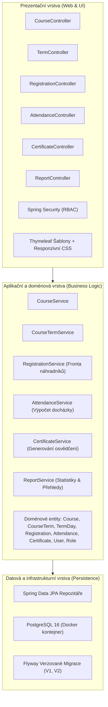
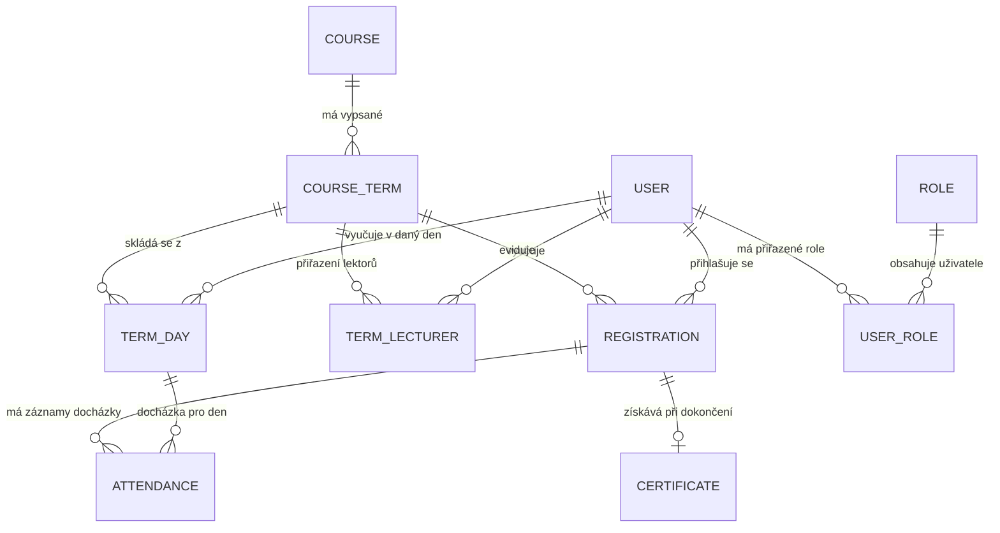

# Akademie Trutnov – Informační systém pro kurzy vzdělávacího centra

> **Předmět:** Pokročilé programování (PPRO) – ZS 2026/2027, FIM UHK  
> **Zadání:** Varianta C – Kurzy vzdělávacího centra  
> **Klient:** Ing. Lucie Bartošová, Akademie Trutnov  
> **Konzultant předmětu:** `dominik.palla@uhk.cz`  
> **Autor projektu:** Matouš Lánský  
> **Repozitář:** `git@gitlab.com:matous.lansky/evidence-kurzu.git`  

---

## 1. Kontext a současný stav (As-Is)

Akademie Trutnov nabízí rekvalifikační a firemní kurzy (přibližně 40 běhů ročně pro veřejnost i firemní zákazníky). Výuku zajišťují externí lektoři.

### Současné fungování a problémy klienta:
* **Přihlášky:** Přicházejí z webového formuláře do e-mailu a ručně se přepisují do tabulky v Excelu (jedna záložka pro každý kurz).
* **Kapacita a pořadník:** Kapacity kurzů se hlídají manuálně („od oka“). Náhradníci (pořadník) jsou řešeni formou tužkových poznámek pod papírovým seznamem.
* **Osvědčení:** Vypisují se ručně v MS Wordu. Čísla osvědčení se přidělují odhadem/pamětí podle počtu vydaných v daném roce, což vedlo k duplicitnímu přidělení stejného čísla.
* **Odhlášení na poslední chvíli:** Největší bolestí klienta je situace, kdy účastník na poslední chvíli účast zruší a organizátor nemá přehled, koho z náhradníků kontaktovat a jaké je jejich závazné pořadí.

---

## 2. Požadavky klienta

### A. Co klient požaduje (Funkční požadavky)
1. **Evidence kurzů:** Název kurzu, anotace, rozsah v hodinách, cena, příznak akreditace (akreditovaný / neakreditovaný).
2. **Termíny kurzů:** Každý kurz se opakuje několikrát do roka. Termín má datum a čas od–do, místo konání (učebnu) a stanovenou kapacitu (kapacita se liší podle kapacity konkrétní učebny).
3. **Lektoři a jejich přiřazení k termínům:** Evidence externích lektorů. Jeden lektor může vést více termínů; u delších kurzů se na jednom termínu střídají dva lektoři.
4. **Přihlášky studentů na termíny:** Evidence studentů/účastníků. Jeden student může navštěvovat více kurzů; na jednom termínu je více studentů.
5. **Kapacita a pořadník (Fronta náhradníků):** Pokud je kapacita termínu naplněna, další zájemce je zařazen do pořadníku s přesným zachováním pořadí registrace. Při uvolnění místa systém identifikuje, kdo je na řadě.
6. **Evidence docházky:** U vícedenních termínů detailní evidence přítomnosti studentů v jednotlivých dnech výuky.
7. **Dokončení a osvědčení o absolvování:** Po skončení termínu generování a evidence seznamu úspěšných absolventů. Vydání osvědčení s unikátním evidenčním číslem a datem vydání (číslo se nesmí opakovat ani měnit).
8. **Statistiky a přehledy:** Přehled naplněnosti jednotlivých termínů, počet odučených hodin podle jednotlivých lektorů a seznam studentů, kteří se v daném roce přihlásili na více než jeden kurz.

---

### B. Obchodní pravidla (Na čem klient trvá)
* **Nepřekročitelnost kapacity:** Kapacitu termínu nelze za žádných okolností překročit.
* **Přísné pořadí v pořadníku:** Pořadí náhradníků se nesmí přeskakovat.
* **Integrita a neměnnost osvědčení:** Číslo osvědčení je striktně jedinečné napříč celým systémem. Již vydané osvědčení je neměnné (auditovatelný záznam se snapshotem dat).
* **Historie a dohledatelnost zrušených přihlášek:** Zrušená přihláška se fyzicky nemaže z databáze (soft-delete se záznamem data a důvodu zrušení), aby bylo možné zpětně doložit průběh přihlášení a reklamací.

---

### C. Doplňková přání a výhled (Nekritické)
* **Budoucí fakturace:** Datový model eviduje ceny kurzů a stav přihlášky pro budoucí napojení fakturačního modulu.
* **Ergonomie a jednoduchost:** Přehledné rozhraní vhodné i pro méně technicky zdatné uživatele (starší externí lektoři).
* **Notifikace:** Příprava na e-mailové notifikace (potvrzení přihlášky, výzva pro náhradníka).
* **Výkazy pro MŠMT:** Agregované přehledy a podklady pro oficiální výkaznictví.

---

### D. Otevřené body klienta a jejich vyřešení
1. **Pravidlo pro úspěšné dokončení kurzu:** Vyřešeno dvoustupňovým schvalováním – systém kontroluje prerekvizitu ≥ 70 % docházky a lektor následně provádí finální potvrzení v rozhraní (ADR-01).
2. **Mechanismus posunu z pořadníku:** Poloautomatický posun – administrátor vidí kontaktní údaje (telefon, e-mail) prvního náhradníka v řadě a po ověření zájmu ho jedním kliknutím povýší na řádného účastníka (ADR-02).
3. **Souběžné přihlášky na více termínů:** Student může mít pouze jednu aktivní řádnou přihlášku na daný kurz; na ostatní termíny může jít pouze do pořadníku (ADR-03).
4. **Přihlášení po zahájení kurzu:** Běžný zápis je po startu zablokován; administrátor může udělit výjimku s povinným vyplněním důvodu (ADR-04).
5. **Dělení hodin mezi lektory:** Rozvrh je členěn na jednotlivé dny výuky (`TermDay`) s vazbou na vyučujícího lektora (ADR-05).

---

### E. Připomínky klienta a jejich promítnutí do řešení
* *„Ať to zvládnou i lektoři, někteří jsou starší pánové.“*  
  → **Řešení:** Uživatelské rozhraní je postaveno na server-side šablonách Thymeleaf s velkými ovládacími prvky, přehlednými tabulkami a jednoduchým zaškrtávacím formulářem docházky (přítomen/nepřítomen/poznámka).
* *„Jednou se stalo, že se číslo osvědčení použilo dvakrát a byl z toho problém.“*  
  → **Řešení:** Generování formátovaného čísla `OSV-YYYY-XXXX` se sekvenční integritou a unikátním indexem v PostgreSQL.
* *„Zrušené přihlášky se nesmí ztratit, lidé pak tvrdí, že se vůbec nehlásili.“*  
  → **Řešení:** Zavedení soft-delete přihlášek se zachováním data zrušení a důvodu (`cancellation_reason`).

---

## 3. Architektura systému

Systém striktně dodržuje třívrstvou architekturu se závislostmi jedním směrem:



---

## 4. Deník architektonických rozhodnutí (ADR)

| ID | Oblast / Téma | Rozhodnutí a zdůvodnění | Stav |
|---|---|---|---|
| **ADR-01** | **Pravidlo dokončení kurzu** | Dvoustupňové ověření: vyžadována minimální docházka 70 % jako systémová podmínka + finální formální potvrzení lektorem v systému. Tím je zaručeno splnění docházky i posouzení znalostí. | **Schváleno** |
| **ADR-02** | **Posun z pořadníku** | Poloautomatický posun: Administrátor vidí pořadník s kontaktními údaji náhradníka (telefon, e-mail) a při uvolnění místa na termínu může prvního náhradníka v pořadí povýšit jedním kliknutím na řádného účastníka bez přeskakování. | **Schváleno** |
| **ADR-03** | **Souběh termínů téhož kurzu** | Student se může přihlásit pouze na jeden aktivní řádný termín daného kurzu; na další termíny může být maximálně v pozici náhradníka v pořadníku. | **Schváleno** |
| **ADR-04** | **Dodatečný zápis po zahájení** | Běžný uživatel se po zahájení termínu zapsat nemůže; zápis po zahájení je umožněn pouze administrátorovi/vedení s povinným vyplněním důvodu výjimky. | **Schváleno** |
| **ADR-05** | **Rozdělení hodin lektorů** | U termínů s více lektory se lektoři přiřazují k jednotlivým dnům/blokům docházky (`TermDay`). Vykazované hodiny lektora se pak počítají ze skutečně odučených bloků. | **Schváleno** |
| **ADR-06** | **Technologický stack** | **Jazyk & Framework:** Java 21 (OpenJDK) + **Spring Boot 3.3.4** (Spring MVC, Thymeleaf, Spring Data JPA, Spring Security).<br>**Prezentační vrstva:** Server-side Thymeleaf šablony s moderním responzivním CSS.<br>**Databáze & Migrace:** PostgreSQL 16 v Dockeru + Flyway pro verzované migrace schématu.<br>**Architektura:** Striktní třívrstvá.<br>**Testování:** JUnit 5, Mockito, Spring Boot Test. | **Schváleno** |

---

## 5. Datový model a doménové entity



### Přehled doménových entit:
1. **Course** – Katalog kurzů (název, anotace, rozsah hodin, cena, příznak akreditace).
2. **CourseTerm** – Konkrétní běh kurzu (termín od–do, učebna/místo konání, kapacita, stav: `PLANNED`, `IN_PROGRESS`, `COMPLETED`, `CANCELLED`).
3. **User & Role** – Uživatelé systému s rolemi (`ROLE_ADMIN`, `ROLE_LECTURER`, `ROLE_STUDENT`) a kontaktními údaji (telefon, e-mail).
4. **TermDay** – Jednotlivé dny výuky termínu (datum, čas od–do, počet hodin, konkrétní vyučující lektor pro daný den, téma).
5. **Registration** – Přihláška studenta na termín. Obsahuje stavy (`CONFIRMED`, `WAITLISTED`, `CANCELLED`, `COMPLETED`, `FAILED`), pozici v pořadníku (`queue_position`), důvod výjimky pro zápis po zahájení a auditní údaje o zrušení (čas a důvod zrušení – soft delete).
6. **Attendance** – Evidence docházky studenta na jednotlivé dny termínu (přítomen: ano/ne, poznámka).
7. **Certificate** – Vydané osvědčení o absolvování kurzu (unikátní evidenční číslo např. `OSV-2026-0001`, datum vydání, auditovatelný snapshot údajů).

---

## 6. Spuštění a testovací data

### Kompletní spuštění v Dockeru (produkční režim):
Celý systém (databáze PostgreSQL i aplikace ve Spring Bootu) se spustí jediným příkazem:
```bash
docker compose up --build
```
Aplikace poběží na adrese: `http://localhost:8080`

### Lokální spuštění při vývoji (dev režim):
```bash
mvn spring-boot:run -Dspring-boot.run.profiles=dev
```

---

### Výchozí syntetické testovací účty:
| Uživatelské jméno | Heslo | Role | Jméno uživatele | Popis oprávnění |
|---|---|---|---|---|
| `admin` | `admin123` | `ROLE_ADMIN`, `ROLE_LECTURER` | Správce Akademie | Plná správa kurzů, termínů, posun náhradníků, statistiky, výjimky |
| `lektor` | `lektor123` | `ROLE_LECTURER` | Ing. Karel Lektor | Zápis denní docházky, schvalování dokončení a certifikátů |
| `petra` | `petra123` | `ROLE_LECTURER` | Mgr. Petra Svobodová | Druhá lektorka pro kurzy se střídáním lektorů (ADR-05) |
| `student` | `student123` | `ROLE_STUDENT` | Jan Novák | Prohlížení katalogu, přihlašování, přehled vlastních přihlášek |
| `eva` | `eva123` | `ROLE_STUDENT` | Eva Černá | Studentka (zapsána na více kurzech) |
| `tomas` | `tomas123` | `ROLE_STUDENT` | Tomáš Dvořák | Student (zapsán na kurzech Java, Foto, Kybernetika) |
| `lucie` | `lucie123` | `ROLE_STUDENT` | Lucie Veselá | Studentka (náhradnice v pořadníku #1 na kurzu Java) |
| `martin` | `martin123` | `ROLE_STUDENT` | Martin Horák | Student (náhradník v pořadníku #2 na kurzu Java) |

---

### Předvyplněná ukázková data (automaticky inicializována):
* **Kurzy (8):** Java a Spring Boot (akreditovaný), Podvojné účetnictví (akreditovaný), Digitální fotografie, Projektové řízení (akreditovaný), Efektivní komunikace, Tvorba webových stránek, Mzdové účetnictví (akreditovaný), Kybernetická bezpečnost.
* **Termíny (8 různých běhů pokrývajících všechny stavy):**
  * `PLANNED` (Java) – plná kapacita 3/3, 2 střídající se lektoři (Karel & Petra), 2 náhradníci v pořadníku (#1 Lucie, #2 Martin).
  * `COMPLETED` (Účetnictví) – proběhl v minulosti, 100% docházka, vydána ověřitelná osvědčení `OSV-2026-0001` a `OSV-2026-0002`.
  * `IN_PROGRESS` (Fotografie) – probíhá výuka, zapsána docházka na prvním dni.
  * `PLANNED` (Projektové řízení, Web, Mzdy) – otevřené běhy s volnými místy pro přihlášení.
  * `COMPLETED` (Kybernetická bezpečnost) – dokončený kurz s vydanými osvědčeními `OSV-2026-0003` a `OSV-2026-0004`.
  * `CANCELLED` (Komunikace) – zrušený termín s evidovaným důvodem zrušení.

---

## 7. Automatizované testy

Projekt obsahuje sadu **35 automatizovaných testů** (unit i integrační testy), které pokrývají všechny klíčové business uzly:

* **RegistrationServiceTest:**
  * Nepřekročitelnost kapacity termínu.
  * Automatické zařazení do pořadníku (stav `WAITLISTED`) s přesným číslováním pozice.
  * Poloautomatický posun náhradníka při uvolnění místa (ADR-02) bez přeskakování.
  * Kontrola zákazu souběhu aktivních řádných termínů téhož kurzu (ADR-03).
  * Zákaz zápisu po zahájení kurzu pro studenta a povolení výjimky pro administrátora (ADR-04).
  * Soft-delete zrušených přihlášek se zachováním historie pro reklamace.
* **CertificateServiceTest:**
  * Vyhodnocení minimální 70% docházky jako prerekvizity pro vydání osvědčení (ADR-01).
  * Zamítnutí vydání osvědčení při nedostatečné docházce.
  * Striktní unikátnost čísla osvědčení ve formátu `OSV-YYYY-XXXX`.
  * Neměnnost a integrita již vydaného osvědčení.
* **AttendanceServiceTest:**
  * Přesný výpočet procentuální docházky studenta na základě přítomnosti v jednotlivých dnech rozvrhu.
* **ReportServiceTest:**
  * Výpočet obsazenosti a procentuálního vytížení termínů.
  * Vykazování hodin lektorů podle skutečně odučených dnů rozvrhu (ADR-05).
  * Detekce a přehled studentů přihlášených na více než 1 kurz v daném kalendářním roce.
* **CourseServiceTest & Kontrolery (MockMvc):**
  * Správa katalogu kurzů, autorizace a zabezpečení přístupových práv dle rolí (Spring Security).

### Spuštění testů:
```bash
mvn test
```
